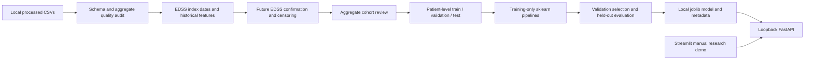

# Multiple Sclerosis Disability Progression Prediction Platform

Local research MVP for the question: **Can longitudinal routinely collected clinical data predict confirmed EDSS disability progression during the following 24 months in people with MS?**

**Research prototype only. Not validated for clinical decision-making. Not intended to diagnose MS progression or recommend treatment.**

This is EDSS-based confirmed disability progression, **not PIRA**. `relapse_therapy.csv` describes relapse-treatment episodes and is not assumed to be a complete confirmed-relapse registry. The source schema and privacy requirements are in [DATA_INFORMATION.md](DATA_INFORMATION.md). No patient dataset or pretrained model is distributed. No real data were accessed during development.

## Architecture and files



```text
configs/             data schemas, cohort, features, outcome and training settings
src/data/            loading, schema validation, aggregate quality reports
src/cohort/          index selection, EDSS outcome and snapshot construction
src/features/        demographics, EDSS, SDMT, functional, DMT, relapse treatment
src/modeling/        patient splits, sklearn pipelines, training, persistence
src/evaluation/      metrics, patient bootstrap, plots, tree SHAP
scripts/             audit_data, build_cohort, train_models, evaluate_models
api/main.py          inference service
dashboard/app.py    Streamlit dashboard
tests/              tiny in-memory mocks; no generated patient dataset
models/              trained artifacts (ignored by Git)
reports/             aggregate reports and figures (ignored by Git)
artifacts/           private cohort/evaluation cache, created at runtime (ignored)
```

### Data tables

All nine documented filenames and columns are validated. Keep `study_id` as a string, including leading zeros. Additional columns may be present but are never automatically selected as features.

| File | Approximate rows | V1 use |
|---|---:|---|
| patients.csv | 2,658 | Historical age, sex, onset and disease duration |
| edss.csv | 30,516 | Index dates, trajectories, future outcome |
| sdmt.csv | 11,432 | Cognitive trajectory |
| clinical_tests.csv | 8,135 | T25FW, right/left 9HPT, PASAT |
| treatments.csv | 4,826 | DMT exposure and treatment starts |
| relapse_therapy.csv | 4,415 | Treatment episodes, not confirmed relapses |
| csf.csv | 1,871 | Load and audit only |
| vas_qol.csv | 7,356 | Load and audit only |
| eq5d.csv | 5,604 | Load and audit only; no utility calculation |

The audit reports missing/invalid dates, ambiguous slash dates, invalid numeric conversions, duplicate rows/patient dates, orphan identifiers, configured categorical/range violations, before-birth dates, end-before-start episodes, DMT overlap, nonpositive timed tests, and numeric distributions. Missingness is reported by variable/table/calendar year and as an **aggregate distribution** across patients. Annual tables/plots cover patients, EDSS, SDMT, functional tests, treatment starts and relapse-treatment episodes; a separate table estimates year-end DMT exposure. No patient rows or IDs are printed in logs/reports.

Invalid conversions become missing **with counts in the audit**; rows are not silently discarded. Core modeling tables fail validation on unusable chronology, invalid numerics, out-of-range configured scores or missing/orphan identifiers. Audit-only tables can retain flagged values for review. Missing EDSS scores cannot form index dates or outcome evidence and their count is reported. Exact repeated measurements are counted once for feature/outcome construction; conflicting same-day EDSS stops cohort building for resolution; valid overlapping DMT episodes are handled as warnings. SDMT and functional visits are reconciled per patient/date in the modeling view: each variable retains its sole distinct non-null value, or becomes missing if values conflict. Other same-day variables remain available. Aggregate reconciliation counts include exact duplicate-only groups, conflicting groups and conflicting group/variable cells set missing; source rows remain unchanged. Invalid DMT intervals (end before start) are flagged, retained unchanged in loaded data, and excluded from temporal DMT calculations with aggregate warning counts. Nothing edits the input CSVs.

## Cohort and outcome

One row represents **one patient at one EDSS measurement date**. Defaults: adults aged at least 18, a 24-month trajectory lookback, a 24-month prediction horizon, and at least 12 calendar months between index dates. Missing birth dates prevent age-based eligibility. Index spacing is greedy and determined before future outcome labels; changing follow-up cannot change earlier index selection. A prior 24 months of visits is not an eligibility requirement: sparse history stays missing and is described in the report.

Provisional worsening thresholds relative to **index EDSS** live only in `configs/outcome.yaml`:

| Index EDSS | Required increase |
|---|---:|
| 0 | 1.5 |
| 0.5–5.5 | 1.0 |
| 6–10 | 0.5 |

EDSS is validated on the 0–10 half-step scale. Defaults require a confirming EDSS 3–6 calendar months after the worsening measurement. Both the first worsening and confirmation must fall within the prediction horizon. Any intervening observation below the worsening threshold invalidates that episode; a later rise can start a new episode. Confirmation is sustained across **observed** assessments, not proof of continuously sustained worsening between visits. Confirmed positives do not need follow-up through the full horizon.

Negatives require an EDSS at or after the horizon, no more than 6 months later, and no observation gap greater than 12 months from the index to that assessment. An unresolved worsening episode without timely assessable confirmation is censored. A stable but short or sparsely observed trajectory is also censored, never automatically negative. Worsening first seen at a post-horizon boundary assessment is censored because its onset timing is uncertain. A worsening near month 24 with confirmation after month 24 is censored under this V1 definition. Recovery outside the permitted confirmation window does not retrospectively resolve an unassessable episode. These deliberately conservative rules can reduce sample size and introduce ascertainment bias; review the resulting prevalence and censoring carefully.

`reports/cohort_summary.json` contains candidate and eligible index counts, unique patients, positive/negative/censored counts, reasons, prevalence among known labels and feature missingness. **Censored rows are retained in the private cohort artifact but excluded from binary training.**

## Features and leakage prevention

Only explicitly enumerated features enter the models. Measurement histories are cut at the index date before calculations; future EDSS is read separately for outcome construction. Patient identifiers, index dates, outcome reasons and follow-up fields cannot enter a model pipeline.

- Age derives from birth date. Disease duration and age at onset derive from an onset date no later than index. Birth/onset/sex are assumed to be historically valid retrospective attributes; recording/availability timestamps are unavailable.
- Undated smoking status remains missing. Exported age-at-onset summaries and future clinical-phase/death/follow-up summaries are not used.
- `current_edss` is the index score; previous EDSS strictly precedes index. Latest SDMT/functional values can use any earlier measurement. They are not forward-filled from future records.
- Changes compare latest historical measurement with the last measurement **at or before** the 12/24-month reference date, within a configurable 6-month tolerance. No interpolation from later measurements; an unavailable/stale reference yields missing. SDMT has an explicit recency feature; functional staleness remains a limitation.
- EDSS/SDMT slopes are score units per year. EDSS statistics and slopes use the configured trajectory lookback; sample standard deviation needs two observations. For compatibility, names ending `_24m` are retained if `lookback_months` changes; metadata records the actual setting. Named 12/24-month changes and 6/12/24-month episode counts retain their explicit windows. Review this distinction before changing defaults.
- Nonpositive walking/peg times are audited and treated as missing by the prespecified feature policy. PASAT outside 1–60 (including historical zero placeholders) becomes missing only in the modeling view; the audit separately counts zero, above-60 and negative values. No missing score is interpreted as impairment. Means supplied in the source are used; trial-level fallback is not invented.
- DMT starts must precede/equal index. Future end dates are masked before deriving exposure; an end at index is treated as stopped. Exported status, latest date, cumulative dose and stopping reason are ignored. Unknown end dates imply continued exposure until a recorded historical end; confirm this assumption.
- Active DMTs count all valid source episodes, including same-INN overlaps and simultaneous starts; episodes are not merged. `current_dmt` is `NONE`, the normalized INN for exactly one episode, or `MULTIPLE`. Duration is available only for exactly one active episode. INNs are stripped and uppercased; missing/empty names become `UNKNOWN`. No brand-to-generic mapping is performed, so COPAXONE 40 MG and GLATIRAMER ACETATE may remain distinct.
- Switch features are removed from C/D. `number_previous_dmts` counts ended valid episodes; `distinct_previous_dmts` counts their distinct normalized known INNs (excluding UNKNOWN). `dmt_starts_previous_24m` counts valid starts within the last 24 calendar months, including index; `days_since_last_dmt_start` uses the latest historical valid start. Overlaps do not imply switches.
- The treatment audit reports overlapping patients and every overlapping episode pair, divided by normalized INN equality (UNKNOWN matches UNKNOWN), excluding invalid intervals. Touching endpoints and zero-duration episodes do not overlap. Audit multiple-active index counts use unique EDSS candidate dates before eligibility/spacing; the cohort summary reports the count for eligible snapshots.
- Relapse-treatment counts use unique available `(start_date, type, inn, corticosteroid)` episode keys, ignoring all end/status/future fields. Missing corticosteroid coding makes the relevant steroid count unknown. Absence of episodes yields zero counts only under the assumption that treatment capture is adequate; it does not prove absence of relapses.

No ARMSS/MSSS summaries, last available clinical follow-up, “most recent info,” death indicators, future treatments or future stop reasons are predictors. Tests explicitly mutate future observations and check that historical features do not change.

## Models and evaluation

| Group | Features |
|---|---|
| A | Age, sex, disease duration, current EDSS |
| B | A + longitudinal EDSS |
| C | B + DMT and relapse-treatment history |
| D | C + SDMT, T25FW, bilateral 9HPT and PASAT |

Each group trains logistic regression, random forest and XGBoost with small fixed defaults: 12 models, plus a logistic baseline using current EDSS alone. No hyperparameter search, deep learning, external tracking or cloud services.

All snapshots from each `study_id` stay in one reproducible 70/15/15 patient split (integer rounding applies). The split is established before censoring exclusion; each resulting labeled partition must contain both classes or training stops. Do not search seeds for favorable results. Numeric median imputation/scaling and categorical missing-value encoding/one-hot encoding are fitted **only on training**. Entirely missing numeric training columns retain a placeholder zero after training-only imputation, without interpreting missing raw tests as zero.

Model selection uses **lowest validation Brier score**, with AUPRC as tie-breaker. The selected model remains fitted on training only; test labels never select models, thresholds, preprocessing or features. Reported probabilities are not post-hoc calibrated; calibration curves assess them. The decision threshold defaults to 0.5, and display risk cutoffs to 0.2/0.5; these are configurable research choices, not clinically validated thresholds.

Every candidate receives held-out AUROC, AUPRC, sensitivity, specificity, PPV, NPV, F1, Brier, prevalence, snapshot/patient alert fractions and alerts per true progression. Undefined ratios/one-class bootstrap AUROCs are reported as null/empty, not invented zeros (F1 follows the explicit zero-division convention of zero). ROC, precision-recall, calibration and confusion-matrix figures are written per model. The default 100-iteration patient-cluster bootstrap resamples whole patients with all their snapshots; reports give percentile intervals and valid replicate counts. Metrics are snapshot-weighted, so frequent attenders contribute more. The modest bootstrap is for iteration, not final publication precision.

SHAP runs only for the **validation-selected best tree** using a limited validation sample. Outputs: global summary, mean absolute SHAP importance, two top-feature dependence plots and a local explanation function. XGBoost SHAP uses log-odds; random forest SHAP uses probability units. Explanations describe associations, never causes. If the inference winner is not the best tree, the dashboard does not substitute explanations from a different model.

Saved artifacts include `models/best_model.joblib`, `models/model_metadata.json`, and `models/best_tree_model.joblib`. Metadata records model/group/schema, timestamp/version, configuration, outcome rules, validation/test metrics, seed and package versions. Private evaluation cache and split assignments permit exact re-evaluation. `evaluate_models.py` reproduces the same held-out evaluation; do not use repeated test inspection to tune the system.

## Local execution

Run from the project root. Python 3.11–3.13 is recommended. Dependency installation needs package access; data processing, training and serving then run locally. This project does not make external service calls.

```bash
python3 -m venv .venv
source .venv/bin/activate
python -m pip install -r requirements.txt
# macOS only, if XGBoost reports missing libomp:
brew install libomp
python -m pytest -q

python scripts/audit_data.py --data-dir /path/to/processed
python scripts/build_cohort.py --data-dir /path/to/processed
```

**Stop and inspect `reports/data_quality.json` and `reports/cohort_summary.json`. Confirm the clinical assumptions/configuration before training.** Section 25 of `DATA_INFORMATION.md` requires this review. The training command requires an explicit acknowledgment:

```bash
python scripts/train_models.py --data-dir /path/to/processed --cohort-reviewed
python scripts/evaluate_models.py
uvicorn api.main:app --host 127.0.0.1 --port 8000 --reload --no-access-log
```

In a second local terminal with the environment activated:

```bash
streamlit run dashboard/app.py --server.address 127.0.0.1 --browser.gatherUsageStats false
```

All scripts support `--config-dir`, `--report-dir`, `--model-dir` and `--artifact-dir`. Corresponding environment variables are listed in `.env.example`; export them in your shell (the file is not automatically loaded). `--data-dir` is always supplied explicitly for audit/build/train. The dashboard uses `MS_REPORT_DIR` and `MS_API_URL`; the API uses `MS_MODEL_DIR`. No workstation-specific path is hard-coded. Keep ports bound to loopback. Restart the API after replacing model files.

Training verifies a fingerprint of the exact nine CSVs and all YAML configurations against the reviewed cohort build. After editing a CSV or configuration, rebuild and review the cohort. File integrity is enforced; the CLI acknowledgment is a human attestation, not an automated clinical validation.

### API

- `GET /health`: service status and whether a trained model is available.
- `GET /model-info`: model metadata and exact feature schema; 503 before training.
- `POST /predict`: one already-engineered record, with **every** schema key present and `null` for missing values. Numeric fields must be finite numbers, categories strings. Extra feature keys and malformed inputs return 422 without echoing submitted values.

```json
{
  "features": {"current_edss": 2.5},
  "include_explanation": false
}
```

This short request applies **only if the EDSS-only baseline won**. For A–D, use exactly the full `feature_list` from `/model-info`. A typical response is:

```json
{
  "progression_probability": 0.23,
  "risk_category": "intermediate",
  "model_version": "example-version"
}
```

The Streamlit form builds itself from this schema and calls only a loopback API. It shows estimated 24-month progression risk (or the configured horizon), category, and contributions when available. It does not display patient histories or upload files. There is no authentication or database.

## Review before training

1. `configs/data.yaml`: date ordering/two-digit-year pivot, categorical coding, SDMT/PASAT/range limits. Slash dates default to US month-first. Years 00–30 map to 2000–2030 and 31–99 to 1931–1999; ambiguous dates are counted. EQ-5D uses provisional dimension levels 1–5; version/value set remain unverified. VAS 0–100 is provisional. Unknown codebooks are not guessed.
2. `configs/outcome.yaml`: baseline worsening thresholds, 3–6-month confirmation, horizon boundary handling, sufficient follow-up and gap rules. These need MS clinical collaborator confirmation; V1 enforces sustained within-horizon confirmation and conservative unresolved-episode censoring.
3. `configs/cohort.yaml`: adult eligibility, index spacing, trajectory window, prediction horizon, split seed, model defaults, display/decision thresholds and bootstrap iterations.
4. `configs/features.yaml`: exact A–D feature lists, reference tolerance, timed-test/PASAT-zero policies. Undated smoking is deliberately unavailable in V1.

## Privacy and limitations

Only the nine named processed files are read: no raw data search, mapping-file access, external APIs or telemetry involving patient data. Streamlit telemetry is disabled; dashboard requests ignore proxy environment variables. The local API is the only prediction endpoint. No database, cloud service or external experiment tracker is used.

`artifacts/` contains sensitive pseudonymized patient-level cohort, split and evaluation information. Models may also retain sensitive information. Reports have no identifiers but can contain small aggregate counts or clinical distributions: **keep all outputs local and access-controlled**. Git ignore rules exclude CSV/Parquet, artifacts, model binaries, reports, environment secrets and caches. Never use `git add -f` on these outputs. Joblib is executable serialization: load only trusted artifacts generated locally. No automatic data deletion or retention policy is implemented.

Limitations include irregular attendance, informative missingness/censoring, retrospective ascertainment, treatment confounding, incomplete episode capture, lack of event-recording timestamps, decades of changing practice, nonindependent repeated snapshots and no external/temporal validation. The negative follow-up policy cannot prove biological absence of progression between visits. No relapse-independent attribution, competing-risk/death modeling, probability recalibration or treatment recommendation is attempted. Display categories are research placeholders. Review coding consistency, overlapping treatments, onset timing and data coverage before interpreting results.

Future MRI integration can add `src/features/mri.py` using the same patient/date cutoff pattern, register it in cohort feature extraction and add a new feature group. Candidate features include whole-brain/gray/white matter volumes, FLAIR lesion volume, T1 black-hole volume, spinal cord area and longitudinal changes. Scanner effects, head-size normalization and study dates will require their own audit. MRI is not implemented in V1.
